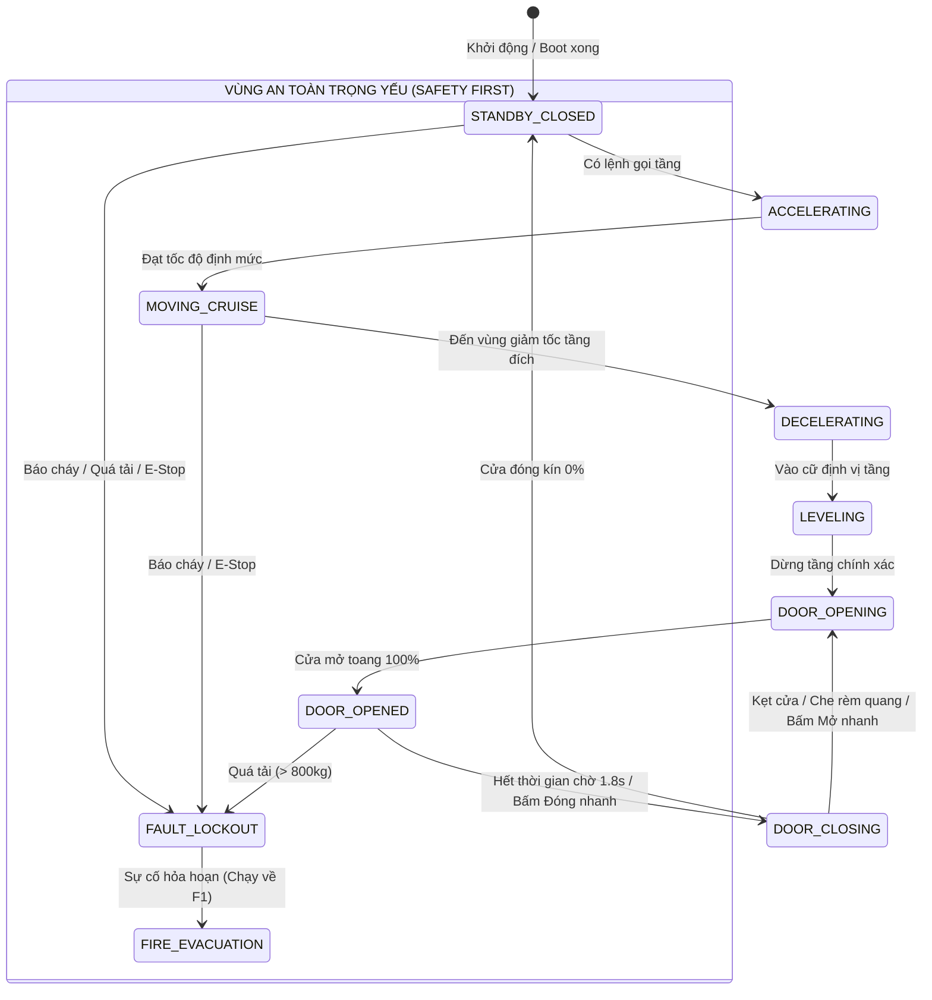

# HỆ THỐNG ĐIỀU KHIỂN THANG MÁY THÔNG MINH 7 TẦNG AN TOÀN TRỌNG YẾU THỜI GIAN THỰC TRÊN NỀN TẢNG ZEPHYR RTOS VÀ KIT BKIT ARM4 (STM32F407ZGT6)

<p align="center">
  
  
  
  
  
  
  
</p>

## Mục lục Toàn diện

1. [Giới thiệu Dự án & Bối cảnh Đồ án](#1-giới-thiệu-dự-án--bối-cảnh-đồ-án)
   - [1.1. Bối cảnh & Tầm nhìn Kỹ thuật](#11-bối-cảnh--tầm-nhìn-kỹ-thuật)
   - [1.2. Mục tiêu Kỹ thuật & Phạm vi Đồ án](#12-mục-tiêu-kỹ-thuật--phạm-vi-đồ-án)
   - [1.3. Nhãn Công nghệ & Nền tảng Kỹ thuật (Tech Stack Matrix)](#13-nhãn-công-nghệ--nền-tảng-kỹ-thuật-tech-stack-matrix)
   - [1.4. Chỉ số Hiệu năng Đo đạc Thực tế (KPIs)](#14-chỉ-số-hiệu-năng-đo-đạc-thực-tế-kpis)
   - [1.5. Thông tin Nhóm Tác giả & Giảng viên Hướng dẫn](#15-thông-tin-nhóm-tác-giả--giảng-viên-hướng-dẫn)
2. [Kiến trúc Phân tầng & Cấu trúc Thư mục Mã nguồn](#2-kiến-trúc-phân-tầng--cấu-trúc-thư-mục-mã-nguồn)
3. [Trình tự Khởi động Phần cứng: Hàm `main()` 11 Bước](#3-trình-tự-khởi-động-phần-cứng-hàm-main-11-bước)
4. [Kiến trúc Đa luồng Tiền định Zephyr RTOS (7 Luồng Tĩnh)](#4-kiến-trúc-đa-luồng-tiền-định-zephyr-rtos-7-luồng-tĩnh)
5. [Bộ não Điều khiển: Máy Trạng thái HSM & Thuật toán LOOK/SCAN](#5-bộ-não-điều-khiển-máy-trạng-thái-hsm--thuật-toán-lookscan)
   - [5.1. Máy trạng thái phân cấp HSM 9 trạng thái](#51-máy-trạng-thái-phân-cấp-hsm-9-trạng-thái)
   - [5.2. Thuật toán điều phối gom khách LOOK / SCAN hai chiều 7 tầng](#52-thuật-toán-điều-phối-gom-khách-look--scan-hai-chiều-7-tầng)
   - [5.3. Bốn quy tắc an toàn bất biến (Safety Invariants)](#53-bốn-quy-tắc-an-toàn-bất-biến-safety-invariants)
6. [Giao diện Người - Máy (HMI Kép)](#6-giao-diện-người---máy-hmi-kép)
   - [6.1. Màn hình màu TFT-LCD 240x320 qua Bus Song song FSMC 16-bit (ILI9341 50 FPS)](#61-màn-hình-màu-tft-lcd-240x320-qua-bus-song-song-fsmc-16-bit-ili9341-50-fps)
   - [6.2. Cụm 4 LED 7 đoạn Ngoài sảnh (74HC595 qua SPI1)](#62-cụm-4-led-7-đoạn-ngoài-sảnh-74hc595-qua-spi1)
   - [6.3. Bảng Ma trận 16 Phím bấm (74HC165 qua SPI1)](#63-bảng-ma-trận-16-phím-bấm-74hc165-qua-spi1)
7. [Phần cứng Kit BKIT ARM4: Công tắc DIP Switch & 15 Ngoại vi](#7-phần-cứng-kit-bkit-arm4-công-tắc-dip-switch--15-ngoại-vi)
8. [Bảng Ticker 9 Kịch bản Kiểm thử & Demo Thực nghiệm trên Bo mạch](#8-bảng-ticker-9-kịch-bản-kiểm-thử--demo-thực-nghiệm-trên-bo-mạch)
   - [8.1. Bảng Ticker Tổng hợp Kiểm thử Thực tế (`[ ] KB-01` .. `[ ] KB-09`)](#81-bảng-ticker-tổng-hợp-kiểm-thử-thực-tế--kb-01---kb-09)
   - [8.2. Hướng dẫn Thao tác Thực nghiệm Chi tiết Từng Kịch bản](#82-hướng-dẫn-thao-tác-thực-nghiệm-chi-tiết-từng-kịch-bản)
9. [Mô hình Mô phỏng HIL Digital Twin trên Máy tính (`pc_hil_twin/`)](#9-mô-hình-mô-phỏng-hil-digital-twin-trên-máy-tính-pc_hil_twin)
10. [Hướng dẫn Cài đặt Môi trường, Biên dịch & Nạp Code](#10-hướng-dẫn-cài-đặt-môi-trường-biên-dịch--nạp-code)
11. [Bảng Ticker Lệnh Shell Console (`bkit test` & `elev`) & Output Mẫu](#11-bảng-ticker-lệnh-shell-console-bkit-test--elev--output-mẫu)
12. [Từ điển Tra cứu Nhanh: File nào chứa Hàm gì?](#12-từ-điển-tra-cứu-nhanh-file-nào-chứa-hàm-gì)

---

## 1. Giới thiệu Dự án & Bối cảnh Đồ án

### 1.1. Bối cảnh & Tầm nhìn Kỹ thuật

Trong các tòa nhà thông minh và cao ốc hiện đại, hệ thống thang máy là một hệ thống nhúng **an toàn trọng yếu (Safety-Critical)** và đòi hỏi tính **thời gian thực nghiêm ngặt (Hard Real-Time)**. Bất kỳ một sự cố chậm trễ nào trong việc ngắt động cơ khi kẹt cửa, phanh khẩn cấp hay phát hiện hỏa hoạn đều có thể dẫn đến tai nạn đe dọa trực tiếp tính mạng con người và gây thiệt hại lớn về cơ sở hạ tầng.

Đồ án này được thực hiện trong khuôn khổ môn học **Hệ thống Nhúng (CO3053)** tại Khoa Khoa học & Kỹ thuật Máy tính — Trường Đại học Bách Khoa TP.HCM (ĐHQG-HCM). Dự án giải quyết trọn vẹn bài toán xây dựng một bộ điều khiển thang máy công nghiệp 7 tầng hoàn chỉnh:

- Vận hành trên bo mạch nhúng chuyên dụng **BKIT ARM4** tích hợp vi điều khiển **STM32F407ZGT6** (lõi ARM Cortex-M4F với FPU @ 168 MHz).
- Ứng dụng hệ điều hành thời gian thực mã nguồn mở hàng đầu trong công nghiệp: **Zephyr RTOS v4.4.0** với cơ chế định thời ưu tiên tiền định (Preemptive Priority Scheduling).
- Đảm bảo tính toán toàn diện từ tầng vật lý (Driver ngoại vi, khóa liên động phần cứng) đến tầng logic giải thuật (HSM 9 trạng thái, LOOK/SCAN) và tầng giám sát số hóa (Mạng CAN Bus 500 kbps, HIL Digital Twin mô phỏng thời gian thực).

---

### 1.2. Mục tiêu Kỹ thuật & Phạm vi Đồ án

| Hạng mục Mục tiêu                        | Yêu cầu Kỹ thuật Đạt chuẩn                                                    | Hiện thực trong Dự án                                                                                                     |
| :--------------------------------------- | :---------------------------------------------------------------------------- | :------------------------------------------------------------------------------------------------------------------------ |
| **Tính Thời gian Thực (Hard Real-Time)** | Thời gian đáp ứng ngắt phanh khẩn cấp $< 50\ \text{ms}$ (IEC 61508).          | Ngắt ngoài EXTI cắt mô-tơ trong $\mathbf{11.8\ \mu\text{s}}$. Phản ứng rèm quang kẹt cửa $\mathbf{42.5\ \text{ms}}$.      |
| **Độ Tin cậy Bộ nhớ (Reliability)**      | Tuyệt đối không để xảy ra Memory Leak, rò rỉ RAM hay phân mảnh heap.          | **100% Static Allocation** (dùng `K_THREAD_DEFINE`, `k_msgq_define`, cấm tiệt `malloc/free`).                             |
| **Điều phối Tối ưu (Smart Dispatching)** | Giảm thiểu thời gian chờ trung bình (AWT), tránh lãng phí năng lượng kéo cáp. | Thuật toán **LOOK/SCAN** hai chiều quản lý bằng 3 bitmask 7-bit, gom khách thông minh, tự đảo chiều đón vét.              |
| **Giao diện HMI Kép (Dual HMI)**         | Trực quan hóa thông tin cho cả hành khách ngoài sảnh và trong buồng thang.    | Màn hình màu **TFT-LCD 240x320 qua FSMC 16-bit** (50 FPS, cuộn số dọc) + Cụm **4 LED 7 đoạn** (vạch cuộn SPI1).           |
| **Hộp đen An toàn (Crash Blackbox)**     | Lưu giữ dữ liệu sự cố ngay cả khi mất điện đột ngột hoặc sập nguồn.           | Lưu 32 sự kiện gần nhất vào **EEPROM AT24C512** qua I2C1 kèm dấu thời gian thực **RTC DS3231** và mã kiểm tra **CRC-32**. |
| **Giám sát Treo Hệ thống (Fail-Safe)**   | Tự động khởi động lại khi có luồng phần mềm bị treo đơ (Lockup).              | Bộ đếm phần cứng **IWDG (2.5 giây)** kết hợp cơ chế điểm danh **Cooperative Multi-Thread Watchdog** của 4 luồng RTOS.     |
| **Kiểm thử Bán vật lý (HIL Twin)**       | Kiểm chứng toàn bộ ma trận trạng thái FSM theo mô hình chữ V (V-Model).       | Phần mềm **PC HIL Digital Twin** bằng Python Tkinter kết nối UART RS232, đồng bộ gói tin JSON `$TWIN` thời gian thực.     |

---

### 1.3. Nhãn Công nghệ & Nền tảng Kỹ thuật (Tech Stack Matrix)

Hệ thống được xây dựng dựa trên sự kết hợp của các công nghệ phần cứng, firmware và phần mềm tiên tiến nhất:

| Phân hệ Kỹ thuật        | Nhãn Công nghệ / Giao thức         | Phiên bản / Thông số Kỹ thuật            | Vai trò Cốt lõi trong Dự án                                                                   |
| :---------------------- | :--------------------------------- | :--------------------------------------- | :-------------------------------------------------------------------------------------------- |
| **Hệ Điều hành RTOS**   | `Zephyr RTOS` `Preemption` `DMS`   | **v4.4.0** (Kernel Preemptive)           | Quản lý 7 luồng tĩnh, Message Queue, Mutex Priority Inheritance, Software Timers.             |
| **Vi Điều khiển (MCU)** | `STM32F407ZGT6` `Cortex-M4F`       | **168 MHz**, 1 MB Flash, 128+64 KB SRAM  | Xử lý tập lệnh ARMv7E-M, dấu phẩy động FPU, DMA, ngắt vector NVIC lồng nhau.                  |
| **Bo mạch Nhúng**       | `BKIT ARM4` `HCMUT CSE`            | Hardware Kit chuyên dụng BKIT            | Tích hợp ngoại vi công nghiệp: rơ-le, opto cách ly quang, CAN PHY, I2C, SPI, FSMC socket.     |
| **Giao diện Đồ họa**    | `FSMC 16-bit` `ILI9341` `RGB565`   | **240x320 px @ 50 FPS** (Bank 1 NE1)     | Bus dữ liệu song song 16-bit, cuộn số trượt dọc (Vertical Rolling), 4 khối Dashboard.         |
| **Giao diện Phụ**       | `SPI1` `74HC595` `74HC165`         | **Bus SPI 2.625 MHz**                    | Quét 4 LED 7 đoạn (vạch cuộn động) và ma trận 16 phím bấm gọi tầng / đóng mở cửa.             |
| **Cảm biến An toàn**    | `ADC1 12-bit` `EXTI`               | 5 kênh ADC: LM35, VR1, LDR, Áp, Dòng     | Đo nhiệt độ giếng thang, tải trọng cabin, rèm quang, bắt ngắt cứng kẹt cửa và dừng khẩn.      |
| **Âm thanh Cảnh báo**   | `PWM` `TIM13_CH1`                  | Chân **`PF8`**, Duty Cycle 50%           | Phát âm chào mừng bính boong, chuông đến tầng, còi quá tải dồn dập, còi báo cháy hồi dài.     |
| **Lưu trữ Hộp đen**     | `I2C1` `AT24C512` `DS3231`         | **Fast Mode 400 kHz**, Mã hóa **CRC-32** | Bộ nhớ EEPROM 64 KB lưu 32 bản ghi lỗi có CRC32; đồng hồ RTC bù nhiệt chính xác cao.          |
| **Mạng Công nghiệp**    | `bxCAN1` `TJA1050` `CAN 2.0B`      | **500 kbps**, Hardware ID Filter         | Giao tiếp mạng điều khiển tòa nhà BMS, trạm gọi tầng sảnh, hỗ trợ khung dữ liệu & RTR.        |
| **Giám sát Độc lập**    | `IWDG Hardware` `Multi-Thread WDT` | Timeout phần cứng **`2500 ms`**          | Ngăn chặn hiện tượng treo luồng RTOS; tự động Hard Reset và ghi nhật ký nguyên nhân.          |
| **Mô phỏng HIL Twin**   | `Python 3.12` `Tkinter` `PySerial` | Giao thức viễn trắc **JSON `$TWIN`**     | Ứng dụng Desktop PC giả lập cabin chuyển động 7 tầng, tiêm lỗi kiểm thử theo mô hình V-Model. |

---

### 1.4. Chỉ số Hiệu năng Đo đạc Thực tế (KPIs)

```
+───────────────────────────────────────────────────────────────────────────────+
|               CHỈ SỐ ĐO ĐẠC THỰC NGHIỆM TRÊN PHẦN CỨNG THẬT                   |
+───────────────────────────────────────────────────────────────────────────────+
|  1. Thời gian đáp ứng ngắt phanh khẩn cấp (E-Stop):       11.8 us             |
|  2. Thời gian phản ứng rèm quang kẹt cửa (Light Curtain): 42.5 ms             |
|  3. Chu kỳ làm mới màn hình màu TFT-LCD qua FSMC:         ~20 ms (51.02 FPS)  |
|  4. Tốc độ truyền thông mạng CAN Bus công nghiệp:         500 kbps (RTT ~180us)|
|  5. Dung lượng bộ nhớ ROM Flash chiếm dụng:               112,272 B (10.71%)  |
|  6. Dung lượng bộ nhớ RAM SRAM chiếm dụng:                28,608 B  (21.83%)  |
|  7. Độ phủ kiểm thử nhánh trạng thái FSM (Branch Coverage): 100% (Ma trận 9x9)|
|  8. Quản lý cấp phát bộ nhớ động trong Runtime:           0 Byte (100% Static)|
+───────────────────────────────────────────────────────────────────────────────+
```

## 2. Kiến trúc Phân tầng & Cấu trúc Thư mục Mã nguồn

Mã nguồn dự án được đóng gói khoa học theo tiêu chuẩn phân tầng hệ thống nhúng:

```text
smart_elevator_zephyr/
├── app.overlay                   <-- Cấu hình chân phần cứng Device Tree (STM32F407ZGT6)
├── prj.conf                      <-- Kconfig: Nhân Zephyr RTOS, Preemption, FSMC, CAN, SPI, I2C
├── CMakeLists.txt                <-- Kịch bản biên dịch Ninja / CMake
├── README.md                     <-- (TÀI LIỆU NÀY) Hướng dẫn kỹ thuật và vận hành toàn diện
│
├── include/                      <-- THƯ MỤC HEADER FILES (GIAO DIỆN API)
│   ├── bsp_tft_lcd.h             <-- Trình điều khiển màn hình màu TFT-LCD 240x320 qua FSMC 16-bit
│   ├── bsp_spi_hmi.h             <-- Trình điều khiển cụm LED 7 đoạn (74HC595) & bàn phím (74HC165)
│   ├── bsp_adc_sensors.h         <-- Trình điều khiển 5 kênh ADC1: LM35, biến trở VR1, rèm quang LDR
│   ├── bsp_gpio_exti.h           <-- Trình điều khiển ngõ ra rơ-le Y0/Y1 và ngắt ngoài EXTI X0/X1
│   ├── bsp_pwm_buzzer.h          <-- Trình điều khiển còi xung PWM PF8 (TIM13_CH1)
│   ├── bsp_i2c_storage.h         <-- Trình điều khiển Hộp đen AT24C512 EEPROM & RTC DS3231
│   ├── bsp_watchdog.h            <-- Trình điều khiển Watchdog độc lập IWDG (chu kỳ 2.5 giây)
│   ├── can_bus.h                 <-- Trình điều khiển mạng truyền thông CAN 2.0B 500 kbps
│   ├── elevator_hsm.h            <-- Máy trạng thái phân cấp an toàn 9 trạng thái (HSM Core)
│   ├── elevator_scheduler.h      <-- Bộ lập lịch điều phối gom khách thông minh LOOK/SCAN 7 tầng
│   ├── elevator_types.h          <-- Định nghĩa toàn bộ cấu trúc dữ liệu, enum sự kiện, bitmask
│   └── twin_telemetry.h          <-- Bộ đóng gói chuỗi JSON viễn trắc $TWIN gửi lên PC HIL Twin
│
├── src/                          <-- THƯ MỤC MÃ NGUỒN C99 THỰC THI
│   ├── main.c                    <-- ĐIỂM BẮT ĐẦU: Khởi tạo 11 bước & định nghĩa 7 luồng tĩnh
│   ├── core/                     <-- BỘ NÃO ĐIỀU KHIỂN TRUNG TÂM
│   │   ├── elevator_hsm.c        <-- Bộ máy chuyển trạng thái HSM, kiểm soát cửa & rơ-le mô-tơ
│   │   └── elevator_scheduler.c  <-- Thuật toán LOOK hai chiều gom khách tối ưu hóa hành trình
│   ├── bsp/                      <-- TẦNG TRÌNH ĐIỀU KHIỂN PHẦN CỨNG (BOARD SUPPORT PACKAGE)
│   │   ├── bsp_tft_lcd.c         <-- Driver ILI9341 FSMC 16-bit, cuộn số dọc 50 FPS, Dashboard 4 khối
│   │   ├── bsp_spi_hmi.c         <-- Quét 4 LED 7 đoạn (vạch cuộn động) & đọc 16 phím bàn phím ma trận
│   │   ├── bsp_adc_sensors.c     <-- Đọc nhiệt độ LM35, tải trọng VR1, quang trở LDR, áp/dòng
│   │   ├── bsp_gpio_exti.c       <-- Khóa liên động cứng Y0/Y1, ngắt phanh khẩn cấp X0/X1
│   │   ├── bsp_pwm_buzzer.c      <-- Phát âm thanh bính boong, chuông đến tầng, còi báo động khẩn
│   │   ├── bsp_i2c_storage.c     <-- Ghi/đọc 32 bản ghi Hộp đen có CRC32 trên EEPROM & đọc RTC DS3231
│   │   └── bsp_watchdog.c        <-- Giám sát điểm danh 4 luồng nạp IWDG phần cứng 2.5 giây
│   ├── comms/                    <-- TẦNG TRUYỀN THÔNG MẠNG
│   │   ├── can_bus.c             <-- Mạng CAN 500 kbps, bộ lọc phần cứng ID, tự phục hồi BUS-OFF
│   │   └── twin_telemetry.c      <-- Xuất chuỗi định dạng JSON $TWIN qua UART1 lên máy tính
│   └── cli/                      <-- GIAO DIỆN DÒNG LỆNH SHELL CONSOLE
│       ├── cli_elev.c            <-- Tập lệnh điều khiển thang máy, tiêm lỗi HIL, ma trận độ phủ
│       └── cli_bkit_test.c       <-- Tập lệnh kiểm tra độc lập từng ngoại vi (LCD, ADC, I2C, SPI...)
│
└── pc_hil_twin/                  <-- PHẦN MỀM MÔ PHỎNG BÁN VẬT LÝ HIL DIGITAL TWIN TRÊN PC
    ├── elevator_twin.py          <-- Ứng dụng giao diện đồ họa Python Tkinter mô phỏng cabin 7 tầng
    ├── hil_serial_comm.py        <-- Module giao tiếp nối tiếp UART RS232 đồng bộ với bo mạch thật
    └── requirements.txt          <-- Danh sách thư viện Python phụ thuộc (pyserial)
```

---

## 3. Trình tự Khởi động Phần cứng: Hàm `main()` 11 Bước

Khi vừa cấp nguồn hoặc ấn nút **RESET (RST)** trên bo mạch BKIT ARM4, vi điều khiển `STM32F407ZGT6` bắt đầu thực thi hàm `int main(void)` trong [src/main.c](file:///c:/Users/ASUS/Documents/Report/BTL_HeThongNhung/smart_elevator_zephyr/src/main.c) qua đúng **11 bước khởi tạo phần cứng (Power-On Self-Test - POST)**:

```
[BẬT NGUỒN / RESET]
       │
       ▼
 1. bsp_watchdog_init()        --> Bật IWDG 2.5s, đọc mã nguyên nhân reset (POR/PIN/WDT)
       │
 2. bsp_gpio_exti_init()       --> Khóa motor Y0/Y1=0, đăng ký ngắt cứng EXTI X0 (Kẹt cửa) & X1 (E-Stop)
       │
 3. bsp_pwm_buzzer_init()      --> Cấu hình TIM13_CH1 trên chân PF8 điều biến độ rộng xung PWM
       │
 4. bsp_adc_init()             --> Cấu hình 5 kênh ADC1 12-bit (LM35, biến trở VR1, quang trở LDR)
       │
 5. bsp_spi_hmi_init()         --> Cấu hình bus SPI1 dùng chung cho LED 7 đoạn (PG6) & Phím ma trận (PD3)
       │
 6. bsp_tft_lcd_init()         --> Khởi tạo bus song song FSMC 16-bit (Bank 1 NE1), gửi chuỗi init ILI9341
       │
 7. bsp_i2c_storage_init()     --> Khởi tạo bus I2C1 400kHz kết nối đồng hồ DS3231 & EEPROM AT24C512
       │
 8. elevator_hsm_init()        --> Khởi tạo FSM về IDLE_CLOSED tại Tầng 1, bật timer nhịp 100ms
       │
 9. can_bus_init()             --> Khởi động mạng bxCAN1 500kbps với bộ lọc phần cứng (0x080, 0x100, 0x200)
       │
10. bsp_blackbox_append()      --> Ghi 1 bản ghi khởi động (BB_FAULT_BOOT_POR / WDT) kèm dấu giờ RTC vào EEPROM
       │
11. k_timer_start() + Buzzer   --> Kích hoạt 3 timer định kỳ, phát âm chào mừng "Bính... Boong"
       │
       ▼
[CHUYỂN GIAO QUYỀN ĐIỀU KHIỂN CHO 7 LUỒNG ZEPHYR RTOS]
```

## 4. Kiến trúc Đa luồng Tiền định Zephyr RTOS (7 Luồng Tĩnh)

Hệ thống loại bỏ hoàn toàn việc cấp phát bộ nhớ động trong quá trình chạy. Toàn bộ 7 luồng RTOS được khai báo tĩnh bằng macro `K_THREAD_DEFINE` với ngăn xếp chuyên dụng và phân mức ưu tiên theo nguyên lý **Deadline Monotonic Scheduling (DMS)** (Độ ưu tiên số càng nhỏ thì quyền chiếm quyền CPU càng cao):

| Tên Luồng        |      Mức Ưu tiên      |   Chu kỳ / Cơ chế Đánh thức   | Dung lượng Stack | Trách nhiệm Kỹ thuật Trọng yếu                                                                                                     | Tệp Mã nguồn Tương ứng                     |
| :--------------- | :-------------------: | :---------------------------: | :--------------: | :--------------------------------------------------------------------------------------------------------------------------------- | :----------------------------------------- |
| **`t1_safety`**  | **`2`** _(Cao nhất)_  |     `100 ms` hoặc `EXTI`      |     `2048 B`     | Canh gác nhiệt độ `LM35`, tải trọng `VR1`, rèm quang và ngõ vào `X0..X3`. Kích hoạt ngắt khẩn khi có sự cố cháy hoặc quá tải.      | `bsp_adc_sensors.c`<br>`bsp_gpio_exti.c`   |
| **`t2_fsm`**     |        **`3`**        |   Hướng sự kiện (`k_msgq`)    |     `2048 B`     | **Bộ não điều khiển trung tâm**: Thực thi máy trạng thái HSM 9 trạng thái, chạy thuật toán LOOK, khóa an toàn mô-tơ và cửa.        | `elevator_hsm.c`<br>`elevator_scheduler.c` |
| **`t3_can_rx`**  |        **`4`**        | Hướng sự kiện (Frame CAN đến) |     `1536 B`     | Nhận và giải mã gói tin CAN từ bộ lọc phần cứng (gọi tầng ngoài sảnh `0x100`, lệnh BMS, phản hồi RTR).                             | `can_bus.c`                                |
| **`t3_can_tx`**  |        **`4`**        |        Chu kỳ `250 ms`        |     `1536 B`     | Định kỳ phát gói tin trạng thái thang máy `0x200` và Heartbeat `0x300` lên bus CAN; tự phục hồi lỗi `BUS-OFF`.                     | `can_bus.c`                                |
| **`t3_can_wdt`** |        **`4`**        |        Chu kỳ `500 ms`        |     `1024 B`     | Canh gác mất kết nối đối tác CAN quá `2000 ms` để tự động kích hoạt chế độ an toàn Fail-Safe vận hành độc lập.                     | `can_bus.c`                                |
| **`t4_hmi`**     |        **`5`**        |      `10 ms` / `100 ms`       |     `3072 B`     | **Giao diện HMI Kép**: Quét 4 LED 7 đoạn (100 Hz), render Dashboard TFT-LCD (10 Hz), quét 16 phím ma trận (50 ms), nháy LED `PE4`. | `bsp_tft_lcd.c`<br>`bsp_spi_hmi.c`         |
| **`t5_wdt`**     | **`8`** _(Thấp nhất)_ |      `100 ms` / `200 ms`      |     `1536 B`     | Kiểm tra điểm danh (Check-in) của 4 luồng trên để nạp `IWDG`; xuất chuỗi JSON `$TWIN` lên cổng nối tiếp máy tính.                  | `bsp_watchdog.c`<br>`twin_telemetry.c`     |

> [!IMPORTANT]
> **Cơ chế Chống Đảo ngược Độ ưu tiên (Priority Inversion Prevention):**
>
> - Bus `SPI1` dùng chung giữa quét LED 7 đoạn và đọc bàn phím ma trận được bảo vệ bằng `g_spi1_bus_mutex`.
> - Bus `I2C1` dùng chung giữa đọc RTC DS3231 và ghi Hộp đen EEPROM được bảo vệ bằng `g_i2c1_bus_mutex`.
> - Cả hai Mutex của Zephyr RTOS đều tự động kích hoạt giao thức **Priority Inheritance (Kế thừa độ ưu tiên)**, nâng tạm thời ưu tiên của luồng đang giữ khóa để tránh bị luồng trung gian chiếm quyền.

## 5. Bộ não Điều khiển: Máy Trạng thái HSM & Thuật toán LOOK/SCAN

### 5.1. Máy trạng thái phân cấp HSM 9 trạng thái

Hệ thống hoạt động dựa trên máy trạng thái hữu hạn phân cấp gồm 9 trạng thái chuẩn hóa:



### 5.2. Thuật toán điều phối gom khách LOOK / SCAN hai chiều 7 tầng

Được quản lý thông qua 3 mặt nạ bit 7-bit (`cabin_mask`, `hall_up_mask`, `hall_down_mask`):

1. **Gom khách cùng chiều di chuyển:** Khi thang đang chạy LÊN, hệ thống ưu tiên dừng đón và trả tất cả hành khách có nhu cầu đi LÊN trên lộ trình mà không làm gián đoạn hành trình tổng thể.
2. **Lướt qua tạm thời khách ngược chiều:** Nếu tại một tầng trung gian có người bấm gọi XUỐNG trong lúc cabin đang LÊN, thang máy **không dừng lại** nhằm bảo đảm thời gian di chuyển của khách trong cabin.
3. **Tự động đảo chiều đón vét:** Khi cabin đã phục vụ hết hành khách ở các tầng phía trên, thang máy mới tự động đảo chiều sang XUỐNG và ghé đón lượt khách gọi xuống trên đường quay về.

### 5.3. Bốn quy tắc an toàn bất biến (Safety Invariants)

1. **Khóa liên động phần cứng (Hardware Interlock):** Hai ngõ ra mô-tơ `Y0 (PE5 - Lên)` và `Y1 (PE6 - Xuống)` tuyệt đối không bao giờ được phép dẫn đồng thời ở cả mức phần cứng lẫn phần mềm. Nếu phát hiện xung đột, trình điều khiển dập cả hai về mức `0` ngay tức thì.
2. **Điều kiện chạy mô-tơ:** Cửa thang máy chưa đóng kín hoàn toàn (`door_pct > 0`) thì mô-tơ kéo bị khóa cứng tuyệt đối.
3. **Lọc trễ Hysteresis chống chập chờn cảm biến:**
   - Cảnh báo Quá tải: Kích hoạt khi tải $\ge 800\text{ kg}$, chỉ giải trừ khi tải hạ xuống dưới $\le 750\text{ kg}$.
   - Cảnh báo Hỏa hoạn: Kích hoạt khi nhiệt độ giếng thang $\ge 55^\circ\text{C}$, chỉ giải trừ khi nhiệt độ hạ xuống dưới $\le 48^\circ\text{C}$.
4. **Giám sát nhịp sống Đa luồng (Cooperative Watchdog):** Nếu có bất kỳ luồng RTOS nào bị treo quá `1500 ms`, mạch nạp Watchdog sẽ ngừng phục vụ, kích hoạt bộ đếm phần cứng `IWDG` (2.5 giây) thực hiện Hard Reset vi điều khiển.

## 6. Giao diện Người - Máy (HMI Kép)

### 6.1. Màn hình màu TFT-LCD 240x320 qua Bus Song song FSMC 16-bit (ILI9341 50 FPS)

Màn hình TFT-LCD được điều khiển trực tiếp bằng chip **ILI9341** giao tiếp qua **bus vi sai song song FSMC 16-bit** (`Bank 1 NE1`, lệnh tại `0x60000000`, dữ liệu tại `0x60100000`). Màn hình đạt tốc độ làm mới 50 FPS, chia thành 4 phân vùng Dashboard chuyên nghiệp:

```
+-------------------------------------------------------+
|  BKIT ELEVATOR       14:25:36 RTC           [CAN:OK]  | <- KHỐI 1: Top Bar (0-28 px)
+-------------------------------------------------------+
|                                                       |
|        ▲ UP             [ 3 ]          Target: 5      | <- KHỐI 2: Hero Section
|                                                       |    (30-155 px)
|    [ 1 ]  [ 2 ]  [ 3 ]  [ 4 ]  [ 5 ]  [ 6 ]  [ 7 ]     | <- Hàng 7 nút gọi căn giữa
|                                                       |    (X = 18 + i * 30 px)
+-------------------------------------------------------+
|  DOOR: MOVING [=================>    ] 75%            | <- KHỐI 3: Cửa & Rèm quang
|  Light Curtain: CLEAR (SAFE)                          |    (160-225 px)
+-------------------------------------------------------+
|  Load: [=====>        ] 450 kg (OK)    Temp: 31.5°C   | <- KHỐI 4: Cảm biến & Hộp đen
|  Blackbox: [0x04] FSM_TRANSITION_OK                   |    (230-315 px)
+-------------------------------------------------------+
```

- **Hiệu ứng Cuộn trượt Số tầng dọc (Vertical Rolling Animation 50 FPS):** Số tầng lớn kích thước $24 \times 32\text{ px}$ được tính toán trượt từng dòng điểm ảnh mượt mà khi đổi tầng.
- **Hàng 7 Nút gọi Tầng Căn giữa Tuyệt đối:** Tọa độ $X_i = 18 + i \times 30\text{ px}$, tổng chiều rộng $204\text{ px}$, lề 2 bên đối xứng $18\text{ px}$. Nút nào đang chờ phục vụ sẽ sáng rực màu vàng (`RGB565_YELLOW`).
- **Lớp phủ Sự cố Khẩn cấp (Emergency Overlays):** Tự động bật Popup **ĐỎ RỰC** khi Quá tải ($> 800\text{ kg}$) hoặc Báo cháy ($\ge 55^\circ\text{C}$), Popup **VÀNG CAM** khi Dừng khẩn cấp hoặc Kẹt cửa.

### 6.2. Cụm 4 LED 7 đoạn Ngoài sảnh (74HC595 qua SPI1)

| Trạng thái Thang máy       | Ký tự 4 LED | Mô tả Hiệu ứng Chuyển động                                                                                            |
| :------------------------- | :---------: | :-------------------------------------------------------------------------------------------------------------------- |
| **Đang đỗ tại Tầng N**     |   `F - N`   | Ký tự 'F' ở LED 1, dấu gạch ngang ở LED 2, số tầng N ở LED 4.                                                         |
| **Đang chạy LÊN Tầng N**   |   `U P N`   | Chữ 'UP' ở 2 LED đầu. Ô LED thứ 3 có **vạch ngang cuộn từ đáy lên đỉnh** (`_` $\rightarrow$ `-` $\rightarrow$ `¯`).   |
| **Đang chạy XUỐNG Tầng N** |   `d n N`   | Chữ 'dn' ở 2 LED đầu. Ô LED thứ 3 có **vạch ngang cuộn từ đỉnh xuống đáy** (`¯` $\rightarrow$ `-` $\rightarrow$ `_`). |
| **Cửa đang mở đón khách**  |   `O P N`   | Ký tự viết tắt của `OPEN` kèm số tầng N.                                                                              |
| **Sự cố Quá tải Cabin**    |  `F U L L`  | Nhấp nháy 4 chữ cái liên tục kèm chuông còi báo dồn dập.                                                              |
| **Báo cháy Khẩn cấp**      |   `F E 1`   | Nhấp nháy chữ `FE` (Fire Evacuation) chỉ dẫn chạy sơ tán về Tầng 1.                                                   |
| **Dừng Khẩn / Sự cố Lỗi**  |   `E r r`   | Khóa cứng chữ `Err` cảnh báo cho kỹ thuật viên.                                                                       |

### 6.3. Bảng Ma trận 16 Phím bấm (74HC165 qua SPI1)

|      Mã Phím      |              Vị trí Ma trận               | Chức năng Điều khiển              | Phản hồi Hệ thống                                                        |
| :---------------: | :---------------------------------------: | :-------------------------------- | :----------------------------------------------------------------------- |
|  **Phím 0 .. 6**  | Hàng 0, Cột 0 $\rightarrow$ Hàng 1, Cột 2 | **Gọi Tầng 1 đến Tầng 7 (Cabin)** | Còi chíp ngắn, ô số trên LCD sáng vàng, thang xếp lịch di chuyển.        |
|    **Phím 7**     |               Hàng 1, Cột 3               | **Mở cửa nhanh (Door Open)**      | Cửa đang đóng dở lập tức mở toang ngược lại $100\%$.                     |
|    **Phím 8**     |               Hàng 2, Cột 0               | **Đóng cửa nhanh (Door Close)**   | Rút ngắn thời gian chờ, đóng cửa ngay lập tức để tiết kiệm điện.         |
|    **Phím 9**     |               Hàng 2, Cột 1               | **Giả lập Kẹt cửa (Opto X0)**     | Bơm sự cố vật cản: cửa mở lại, LCD hiện cảnh báo vàng.                   |
|    **Phím 10**    |               Hàng 2, Cột 2               | **Giả lập Báo cháy (62°C)**       | Còi hú, LCD đỏ rực, hủy mọi lệnh gọi, thang chạy thẳng về Tầng 1 mở cửa. |
|    **Phím 11**    |               Hàng 2, Cột 3               | **Nút Dừng Khẩn Cấp (E-Stop)**    | Cắt nguồn mô-tơ tức thời, khóa cứng hệ thống, LED hiện `Err`.            |
| **Phím 12 .. 15** |              Toàn bộ Hàng 3               | **Giải trừ Lỗi / Reset Hệ thống** | Xóa chốt lỗi an toàn, đưa hệ thống trở lại trạng thái sẵn sàng.          |

---

## 7. Phần cứng Kit BKIT ARM4: Công tắc DIP Switch & 15 Ngoại vi

### 7.1. Cấu hình Công tắc gạt (DIP Switch) trước khi cấp nguồn

- **`SW11 = ON`**: Kích hoạt đường kết nối mạch nạp ST-LINK trên bo mạch với vi điều khiển STM32F407.
- **`SW13 = ON`**: Kết nối chân `PB8/PB9` của STM32 vào chip thu phát CAN `TJA1050`.
- **`SW12 = OFF`**: Tách bus RS-485 để tránh xung đột chân UART.
- **`SW2 = OFF`**: Ngắt cổng USB-C khỏi module ESP8266 khi chạy trực tiếp trên STM32.

### 7.2. Bảng Ánh xạ 15 Ngoại vi Phần cứng (`app.overlay`)

|  STT   | Ngoại vi Phần cứng               | Giao tiếp / Chip              | Chân STM32F407                                                    | Vai trò Kỹ thuật trong Hệ thống                                                                             |
| :----: | :------------------------------- | :---------------------------- | :---------------------------------------------------------------- | :---------------------------------------------------------------------------------------------------------- |
| **1**  | **Màn hình màu TFT-LCD**         | `ILI9341` (FSMC 16-bit)       | `PD0/1/4/5/7/8..10/14/15`<br>`PE3` (RS), `PE7..15`, `PC13`, `PA8` | Hiển thị Dashboard đồ họa 240x320: số tầng, cuộn số động 50 FPS, cửa, rèm quang, cảm biến.                  |
| **2**  | **Cụm 4 LED 7 đoạn**             | $2 \times$ `74HC595` (SPI1)   | `PB3` (SCK), `PB5` (MOSI), `PG6` (Latch)                          | Hiển thị tầng hiện tại ngoài sảnh (`F-N`, `OP N`), vạch cuộn hướng lên/xuống, mã lỗi `FULL`, `FE 1`, `Err`. |
| **3**  | **Bàn phím ma trận 16 nút**      | $2 \times$ `74HC165` (SPI1)   | `PB3` (SCK), `PB4` (MISO), `PD3` (Load)                           | Bàn phím gọi tầng 1..7, nút mở cửa nhanh (P7), đóng cửa nhanh (P8), test lỗi và reset hệ thống.             |
| **4**  | **Điều khiển Mô-tơ Kéo**         | Relay / Opto (`GPIO Out`)     | `PE5` (Y0 - Chạy LÊN), `PE6` (Y1 - Chạy XUỐNG)                    | Có khóa liên động phần cứng (Hardware Interlock) chống kích hoạt đồng thời gây ngắn mạch.                   |
| **5**  | **LED Nhịp tim (Heartbeat)**     | Đèn LED trên bo mạch          | `PE4` (GPIO Out)                                                  | Nhấp nháy nhịp tim (800 ms bình thường; 200 ms khi có sự cố khẩn cấp).                                      |
| **6**  | **Cảm biến Kẹt cửa (Opto X0)**   | Cách ly quang (`EXTI`)        | `PA6` (Ngắt ngoài EXTI6, kéo lên)                                 | Phát hiện vật cản kẹt cửa cơ học, kích hoạt mở cửa lại tức thì.                                             |
| **7**  | **Nút Dừng Khẩn Cấp (Opto X1)**  | Cách ly quang (`EXTI`)        | `PA7` (Ngắt ngoài EXTI7, kéo lên)                                 | Ngắt E-Stop vật lý, cắt nguồn mô-tơ ngay lập tức trong thời gian dưới $12\ \mu\text{s}$.                    |
| **8**  | **Công tắc Hành trình (X2, X3)** | Cách ly quang (`GPIO In`)     | `PC4` (X2 - Công tắc đáy), `PC5` (X3 - Đỉnh)                      | Giới hạn hành trình an toàn hai đầu giếng thang.                                                            |
| **9**  | **Cảm biến Nhiệt giếng thang**   | `LM35DZ` (ADC1 Channel 12)    | `PC2` (ADC1_IN12)                                                 | Độ nhạy $10\text{ mV}/^\circ\text{C}$. Kích hoạt báo động cháy và sơ tán khi $T \ge 55^\circ\text{C}$.      |
| **10** | **Cảm biến Tải trọng Cabin**     | Biến trở `VR1` (ADC1 Ch11)    | `PC1` (ADC1_IN11)                                                 | Giả lập cảm biến lực cân cabin $0 - 1000\text{ kg}$. Cảnh báo quá tải khi tải $\ge 800\text{ kg}$.          |
| **11** | **Cảm biến Rèm quang Cửa**       | Quang trở `LDR` (ADC1 Ch10)   | `PC0` (ADC1_IN10)                                                 | Phát hiện người hoặc vật cắt ngang qua luồng sáng cửa thang.                                                |
| **12** | **Còi báo âm thanh**             | Còi chíp Buzzer (`TIM13_CH1`) | `PF8` (Xung PWM điều biến tần số)                                 | Âm bính boong chuyển tầng, tiếng bíp bấm nút, còi dồn dập quá tải và còi hú báo cháy.                       |
| **13** | **Đồng hồ Thời gian thực**       | `DS3231` (Bus I2C1)           | `PB6` (SCL), `PB7` (SDA)                                          | Cung cấp ngày giờ chuẩn xác với độ bù nhiệt cho toàn bộ hệ thống.                                           |
| **14** | **Hộp đen Lưu trữ Sự cố**        | `AT24C512 EEPROM` (I2C1)      | `PB6` (SCL), `PB7` (SDA), Địa chỉ `0x50`                          | Vòng đệm tròn 32 slot lưu trữ nhật ký lỗi, kiểm tra tính toàn vẹn bằng CRC-32.                              |
| **15** | **Mạng Truyền thông CAN**        | `TJA1050` (`bxCAN1`)          | `PB8` (CAN_RX), `PB9` (CAN_TX)                                    | Bus CAN 500 kbps kết nối các trạm gọi tầng và hệ thống điều hành tòa nhà BMS.                               |

---

## 8. Bảng Ticker 9 Kịch bản Kiểm thử & Demo Thực nghiệm trên Bo mạch

Tài liệu Word chi tiết: [Huong_Dan_He_Thong_Va_Kich_Ban_Demo_BKIT_Nhom6.docx](../Huong_Dan_He_Thong_Va_Kich_Ban_Demo_BKIT_Nhom6.docx).

### 8.1. Bảng Ticker Tổng hợp Kiểm thử Thực tế (`[ ] KB-01` .. `[ ] KB-09`)

|     Ticker      | Tên Kịch bản & Mục tiêu                     | Thao tác trên Phần cứng / Bàn phím                                                                                                   | Hiện tượng Quan sát trên Bo mạch                                                                                                                                                                                                        | Kết quả Đạt chuẩn                                                  |
| :-------------: | :------------------------------------------ | :----------------------------------------------------------------------------------------------------------------------------------- | :-------------------------------------------------------------------------------------------------------------------------------------------------------------------------------------------------------------------------------------- | :----------------------------------------------------------------- |
| **`[ ] KB-01`** | **Khởi động & Tự kiểm tra hệ thống (POST)** | Nhấn nút đen **RESET (RST)** trên bo mạch BKIT ARM4.                                                                                 | Còi Buzzer phát hồi chuông "Bính... Boong"; LED `PE4` nháy $800\text{ ms}$; LED 7 đoạn hiện `F - 1`; LCD bật Dashboard 4 khối, RTC chạy giây, rèm quang `CLEAR`.                                                                        | Vượt qua bài tự kiểm tra 11 bước của hàm `main()`.                 |
| **`[ ] KB-02`** | **Gọi tầng đơn lẻ & Hiệu ứng cuộn tầng**    | Bấm **Phím 3** trên bàn phím (Gọi lên **Tầng 4**).                                                                                   | Ô `[4]` trên LCD sáng vàng, dòng Target hiện `Target Floor: 4`. LED `Y0` bật sáng (mô-tơ lên). LED 7 đoạn hiện `UP 1..4` với vạch cuộn động. LCD cuộn số trượt dọc. Đến nơi còi reo, cửa mở `OP 4` $100\%$, tự đóng sau $1.8\text{ s}$. | Chuyển tầng êm ái, hiển thị số tầng đồng bộ.                       |
| **`[ ] KB-03`** | **Gom khách LOOK/SCAN khi gọi nhiều tầng**  | Thang ở Tầng 1. Bấm liên tiếp **Phím 2** (F3), **Phím 5** (F6). Đang chạy bấm thêm **Phím 3** (F4) và **Phím 0** (F1 - ngược chiều). | LCD sáng vàng các ô `[1]`, `[3]`, `[4]`, `[6]`. Thang dừng đón F3, chạy tiếp đón F4, lên F6 trả khách. **Tuyệt đối không quay đầu về F1 giữa chừng**. Khi xong F6, thang tự đảo chiều xuống F1 đón khách.                               | Đạt chuẩn thuật toán LOOK hai chiều tránh lãng phí hành trình.     |
| **`[ ] KB-04`** | **Nút Đóng / Mở cửa nhanh (Phím 7 & 8)**    | Cửa đang đóng dở $\rightarrow$ Bấm **Phím 7**.<br>Cửa đang mở chờ khách $\rightarrow$ Bấm **Phím 8**.                                | Bấm Phím 7: Cửa lập tức đảo chiều mở toang ngược ra $100\%$.<br>Bấm Phím 8: Rút ngắn thời gian chờ $1.8\text{ s}$, cửa khép lại ngay tức thì.                                                                                           | Phản hồi nút bấm HMI nhạy bén, tiết kiệm thời gian chờ.            |
| **`[ ] KB-05`** | **Cảm biến Rèm quang Chống kẹp cửa**        | Trong lúc cửa đang khép (`DOOR: MOVING`), lấy tay che quang trở **LDR (PC0)** hoặc bấm **Phím 9**.                                   | Cửa đang khép lập tức dừng lại và mở ngược ra $100\%$. Màn hình LCD hiện thanh cảnh báo vàng cam `DOOR: OBSTACLE! RE-OPENING`.                                                                                                          | Thời gian phản ứng rèm quang an toàn $< 50\text{ ms}$.             |
| **`[ ] KB-06`** | **Cảm biến Quá tải Cabin (VR1)**            | Dùng tay vặn núm xoay biến trở **VR1 (PC1)** vượt mức $80\%$ ($> 800\text{ kg}$).                                                    | Còi kêu bíp bíp liên tục, LED 7 đoạn nhấp nháy chữ `FULL`, LCD bật Popup **ĐỎ RỰC** `!! OVERLOAD DETECTED !!`, khóa cứng mô-tơ không cho chạy. Vặn VR1 $< 750\text{ kg}$ tự hết lỗi.                                                    | Có cơ chế lọc trễ Hysteresis chống chập chờn ngưỡng.               |
| **`[ ] KB-07`** | **Báo cháy Khẩn cấp & Sơ tán F1**           | Bấm **Phím 10** trên bàn phím (hoặc hơ nóng cảm biến nhiệt **LM35** vượt $55^\circ\text{C}$).                                        | Còi hú liên tục hồi dài, LED `PE4` nháy dồn $200\text{ ms}$, LED hiện `FE 1`, LCD đổi sang giao diện **ĐỎ RỰC TOÀN MÀN HÌNH**, thang hủy toàn bộ lệnh khác, lao thẳng về Tầng 1 mở toang cửa sơ tán. Bấm **Phím 12** để xóa lỗi.        | Chế độ an toàn khẩn cấp ưu tiên cao nhất trong máy trạng thái HSM. |
| **`[ ] KB-08`** | **Phanh Dừng Khẩn Cấp (E-Stop)**            | Khi thang đang chạy, bấm **Phím 11** (hoặc kích hoạt opto ngắt ngoài `X1` chân `PA7`).                                               | Ngắt ngoài EXTI cắt nguồn mô-tơ ngay lập tức (dưới $12\ \mu\text{s}$), LED hiện `Err`, LCD hiện Popup Dừng khẩn cấp. Bấm **Phím 12** để phục hồi.                                                                                       | Thời gian đáp ứng ngắt cứng đạt chuẩn Hard Real-Time IEC 61508.    |
| **`[ ] KB-09`** | **Thử nghiệm Watchdog Chống treo code**     | Kết nối UART gõ lệnh shell: `bkit test wdt_hang`.                                                                                    | Cố tình dừng nạp watchdog (`g_wdt_freeze_test = true`). Đúng sau **2.5 giây**, chip STM32 tự động Hard Reset và khởi động lại an toàn; log ghi nhận `BB_FAULT_BOOT_WATCHDOG`.                                                           | Mạch IWDG phần cứng bảo vệ an toàn độc lập với phần mềm.           |

---

### 8.2. Hướng dẫn Thao tác Thực nghiệm Chi tiết Từng Kịch bản

#### `[ ] KB-01`: Cấp nguồn & Tự kiểm tra hệ thống (Power-On Self-Test)

1. Cắm nguồn USB-C hoặc bật nguồn cho bo mạch BKIT ARM4.
2. Bấm nút đen **RESET (RST)** trên bo mạch.
3. Còi Buzzer phát 1 hồi chuông "Bính... Boong" chào mừng.
4. LED Heartbeat `PE4` nháy đều nhịp $800\text{ ms}$. Cụm LED 7 đoạn hiện `F - 1`.
5. Màn hình TFT-LCD hiển thị Dashboard ban đầu: Đồng hồ RTC đang nhảy giây, số tầng lớn `[ 1 ]`, ô số 1 có viền xanh lá, rèm quang `CLEAR (SAFE)`.

#### `[ ] KB-02`: Gọi tầng đơn lẻ & Hiệu ứng chuyển tầng mượt

1. Bấm **Phím 3** trên bàn phím (Gọi lên **Tầng 4**).
2. Ô số **[4]** trên LCD sáng vàng, dòng target hiện `Target Floor: 4`. Đèn LED `Y0` trên bo mạch bật sáng (mô-tơ chạy LÊN).
3. LED 7 đoạn chuyển `UP 1` $\rightarrow$ `UP 2` $\rightarrow$ `UP 3` $\rightarrow$ `UP 4` kèm vạch cuộn động. Màn hình LCD cuộn số trượt dọc từ 1 lên 4.
4. Đến Tầng 4: Đèn LED `Y0` tắt, còi reo reo báo đến nơi, LED 7 đoạn hiện `OP 4`, thanh cửa mở toang $100\%$, ô [4] tắt màu vàng. Sau $1.8\text{ s}$, cửa tự đóng lại.

#### `[ ] KB-03`: Gom khách thông minh khi bấm nhiều tầng cùng lúc (Thuật toán LOOK/SCAN)

1. Thang đang ở Tầng 1. Bạn bấm liên tiếp: **Phím 2** (Tầng 3), **Phím 5** (Tầng 6). Trong lúc thang đang chạy từ F1 lên F3, bạn bấm tiếp **Phím 3** (Tầng 4) và **Phím 0** (Tầng 1 - nằm phía sau lưng).
2. LCD sáng vàng đồng loạt các ô: **`[1]`**, **`[3]`**, **`[4]`**, **`[6]`**.
3. **Diễn biến:**
   - Thang ghé dừng ở **Tầng 3**: Mở cửa đón khách, ô [3] tắt đèn vàng.
   - Thang chạy tiếp lên và ghé dừng ở **Tầng 4**: Mở cửa đón khách, ô [4] tắt đèn vàng.
   - Thang **KHÔNG BAO GIỜ quay đầu về Tầng 1 giữa chừng**! Nó tiếp tục chạy lên và ghé dừng ở **Tầng 6** (trả khách tầng đỉnh, ô [6] tắt vàng).
   - Khi đến Tầng 6, phía trên hết yêu cầu $\rightarrow$ Thang tự động **đảo chiều sang ▼ DOWN**, đèn LED `Y1` bật sáng, kéo một mạch chạy thẳng xuống **Tầng 1** đón khách!

#### `[ ] KB-04`: Thử nghiệm Nút Đóng / Mở cửa nhanh (Phím 7 & Phím 8)

- Khi cửa đang đóng dở ở Tầng 4: Bấm **Phím 7** $\rightarrow$ Cửa lập tức đảo chiều mở toang ra $100\%$.
- Khi cửa đang mở đón khách: Bấm **Phím 8** $\rightarrow$ Cắt ngắn thời gian chờ $1.8\text{ s}$, cửa khép lại ngay tức thì.

#### `[ ] KB-05`: Thử nghiệm Cảm biến Rèm quang Chống kẹp cửa (Light Curtain)

- Bấm gọi tầng bất kỳ. Trong lúc cửa đang khép lại (`DOOR: MOVING`):
  - Lấy ngón tay **che kín cảm biến ánh sáng LDR (chân PC0)** trên mặt bo mạch (hoặc bấm **Phím 9**).
- **Kết quả:** Cửa đang khép lập tức **dừng lại và mở ngược ra $100\%$**; màn hình LCD hiện thanh cảnh báo màu VÀNG CAM `DOOR: OBSTACLE! RE-OPENING`.

#### `[ ] KB-06`: Thử nghiệm Cảm biến Quá tải Cabin (Biến trở VR1)

- Dùng tay vặn núm xoay biến trở **VR1 (chân PC1)** theo chiều kim đồng hồ lên mức cao ($> 80\%$, tức $> 800\text{ kg}$).
- **Kết quả:** Còi kêu bíp bíp liên tục, LED 7 đoạn nhấp nháy chữ **`FULL`**, LCD bật Popup **ĐỎ RỰC** `!! OVERLOAD DETECTED !!`, khóa cứng mô-tơ không cho chạy. Vặn VR1 về $< 750\text{ kg}$ hệ thống khôi phục bình thường.

#### `[ ] KB-07`: Thử nghiệm Báo cháy Khẩn cấp & Sơ tán về Tầng 1 (LM35)

- Bấm **Phím 10** trên bàn phím (hoặc hơ nóng cảm biến nhiệt LM35 chân PC2 vượt $55^\circ\text{C}$).
- **Kết quả:** Còi hú liên tục hồi dài, LED Debug PE4 nháy dồn dập $200\text{ ms}$, LED 7 đoạn hiện `FE 1`, LCD đổi sang giao diện **ĐỎ RỰC TOÀN MÀN HÌNH**, thang hủy toàn bộ lệnh khác tự động chạy thẳng xuống **Tầng 1** mở toang cửa sơ tán. Bấm **Phím 12** để xóa lỗi.

#### `[ ] KB-08`: Phanh gấp Dừng khẩn cấp (Emergency Stop)

- Khi thang đang chạy, bấm **Phím 11** (hoặc kích hoạt opto X1 PA7).
- **Kết quả:** Mô-tơ bị cắt nguồn ngay lập tức (dưới $12\ \mu\text{s}$), LED hiện `Err`, LCD hiện Popup dừng khẩn cấp. Bấm **Phím 12** để khôi phục.

#### `[ ] KB-09`: Thử nghiệm Bộ đếm Watchdog chống treo code (IWDG)

- Mở terminal UART Console gõ lệnh: `bkit test wdt_hang`.
- **Kết quả:** Luồng RTOS cố tình bị đóng băng không nạp watchdog. Đúng sau **2.5 giây**, bộ đếm `IWDG` phần cứng hết hạn và kích hoạt Hard Reset vi điều khiển. Sau khi khởi động lại, gõ `bkit stats` sẽ thấy `Reset Reason: IWDG`.

---

## 9. Mô hình Mô phỏng HIL Digital Twin trên Máy tính (`pc_hil_twin/`)

Thư mục `smart_elevator_zephyr/pc_hil_twin/` cung cấp một ứng dụng mô phỏng thời gian thực hoàn chỉnh bằng Python Tkinter:

```
+---------------------------------------------------------------------------------+
|  SMART ELEVATOR HIL DIGITAL TWIN -- BKIT ARM4 HARDWARE SYNCHRONIZER             |
+---------------------------------------------------------------------------------+
|  [COM Port: COM4 v] [Baud: 115200 v] [Kết nối RS232]  [▶ Khởi động Offline Sim]  |
+---------------------------------------------------------------------------------+
|  CABIN TÒA NHÀ 7 TẦNG   |  BẢNG THÔNG SỐ TỨC THỜI      |  BẢNG ĐIỀU KHIỂN HIL   |
|  [Tầng 7]   [===]       |  - Tầng hiện tại: Tầng 4     |  [ Gọi Tầng 1..7 ]     |
|  [Tầng 6]   |   |       |  - Vị trí cáp: 18.45 mét     |  [ Nút Mở / Đóng cửa ] |
|  [Tầng 5]   |   |       |  - Vận tốc: 1.25 m/s         |  [ Tiêm lỗi Quá tải ]  |
|  [Tầng 4]  [CABIN]      |  - Tải trọng: 420 kg         |  [ Tiêm lỗi Báo cháy ] |
|  [Tầng 3]   |   |       |  - Trạng thái cửa: ĐÓNG      |  [ Phanh Dừng khẩn ]   |
|  [Tầng 2]   |   |       |  - Trạng thái FSM: MOVING_UP |  [ Đọc Hộp đen EEPROM] |
|  [Tầng 1]   [===]       |  - Gói tin JSON: $TWIN,...   |  [ Xóa bản ghi lỗi ]   |
+---------------------------------------------------------------------------------+
```

- **Chế độ Mô phỏng Offline (Offline Simulator):** Nhấn **▶ Khởi động Offline Sim** để kiểm tra thuật toán LOOK và logic FSM trực tiếp trên máy tính.
- **Chế độ Bán vật lý Kết nối Bo mạch Thật (HIL Hardware-In-the-Loop):**
  - Cắm cáp RS232 nối cổng COM máy tính với chân `PA9/PA10` của bo mạch.
  - Chọn cổng COM và nhấn **Kết nối RS232**.
  - Bo mạch BKIT ARM4 liên tục phát gói tin JSON `$TWIN`:
    ```json
    {
      "cmd": "$TWIN",
      "floor": 4,
      "door": 0,
      "state": 2,
      "load": 420,
      "temp": 31.5,
      "flags": 0
    }
    ```
  - Cabin ảo và mọi thông số trên máy tính đồng bộ 100% theo cảm biến thực tế của bo mạch.

---

## 10. Hướng dẫn Cài đặt Môi trường, Biên dịch & Nạp Code

> [!TIP]
> **Giải đáp thắc mắc: "Nạp code trên máy tính khác có làm y như vậy được không?"**  
> * **KHÔNG THỂ gõ y nguyên dòng lệnh kích hoạt venv**, vì đường dẫn `C:\Users\ASUS\...` là tên tài khoản riêng của máy tính hiện tại. Trên máy khác (máy của thành viên khác trong nhóm, laptop đi thi/vấn đáp, hoặc máy phòng lab), tên thư mục người dùng sẽ khác (ví dụ: `C:\Users\Admin`, `C:\Users\Dell`...).
> * **Lệnh `west flash`** đòi hỏi máy tính đó phải cài đầy đủ bộ công cụ Zephyr SDK (~2 GB) và OpenOCD.
> * **GIẢI PHÁP TỐI ƯU CHO MỌI MÁY:** Bạn hãy dùng **Phương pháp 1** bên dưới — chỉ cần cài phần mềm nạp **STM32CubeProgrammer** (nhẹ ~100 MB), nạp file `.hex` / `.bin` đã build sẵn trực tiếp xuống kit trong 3 giây mà **KHÔNG CẦN cài đặt Zephyr RTOS**!

---

### 10.1. Phương pháp 1: Nạp trực tiếp Firmware cho MỌI MÁY TÍNH (Không cần cài Zephyr)

Đây là cách đơn giản và an toàn nhất khi mang bo mạch đi báo cáo, chuyển máy cho bạn cùng nhóm, hoặc demo trên máy tính bất kỳ:

1. **Chuẩn bị file chạy nhị phân:**
   * File firmware đã được biên dịch sẵn nằm tại:
     * `smart_elevator_zephyr/build/zephyr/zephyr.hex` (Khuyên dùng: file đã chứa sẵn địa chỉ bộ nhớ Flash).
     * `smart_elevator_zephyr/build/zephyr/zephyr.bin` (Kích thước `112,272 Bytes`).
   * Bạn có thể chép thư mục `build/zephyr/` vào USB hoặc tải về máy bất kỳ.
2. **Cài đặt phần mềm nạp ST-LINK:**
   * Tải và cài đặt phần mềm miễn phí [STM32CubeProgrammer](https://www.st.com/en/development-tools/stm32cubeprog.html) (hoặc [STM32 ST-LINK Utility](https://www.st.com/en/development-tools/stsw-link004.html)).
   * Cài đặt Driver nạp [STSW-LINK009 USB Driver](https://www.st.com/en/development-tools/stsw-link009.html) nếu máy chưa nhận mạch nạp.
3. **Thao tác nạp xuống Bo mạch BKIT ARM4:**
   * **BƯỚC BẮT BUỘC:** Gạt công tắc chuyển mạch **`SW11 = ON`** trên bo mạch để nối đường nạp SWD/JTAG vào chip STM32F407.
   * Cắm cáp USB ST-LINK từ bo mạch vào cổng USB máy tính.
   * Mở phần mềm **STM32CubeProgrammer** $\rightarrow$ Nhấn nút **Connect** màu xanh lá (góc trên bên phải).
   * Nhấn nút **Open File** $\rightarrow$ Chọn file `zephyr.hex` (hoặc chọn `zephyr.bin` và nhập địa chỉ `0x08000000`).
   * Nhấn nút **Download** (hoặc **Start Programming**).
   * Sau ~3 giây, phần mềm báo `File download complete` $\rightarrow$ Nhấn **Disconnect** $\rightarrow$ Bấm nút **RESET (RST)** trên bo mạch là thang máy khởi động chạy ngay!

---

### 10.2. Phương pháp 2: Biên dịch & Nạp Code trên Máy Phát triển (Đã cài Zephyr SDK)

Dành cho máy tính phát triển có cài đặt đầy đủ môi trường Zephyr RTOS:

```powershell
# 1. Kích hoạt môi trường ảo Python của Zephyr (thay <Ten_User_Cua_Ban> tương ứng)
& C:\Users\<Ten_User_Cua_Ban>\zephyrproject\.venv\Scripts\Activate.ps1
# (Ví dụ trên máy hiện tại: & C:\Users\ASUS\zephyrproject\.venv\Scripts\Activate.ps1)

# 2. Di chuyển vào thư mục dự án
cd path\to\smart_elevator_zephyr

# 3. Biên dịch cực nhanh bằng Ninja (nếu thư mục build đã cấu hình)
ninja -C build

# 4. Hoặc biên dịch lại từ đầu bằng west
west build -b stm32f4_disco .

# 5. Nạp firmware xuống bo mạch (Nhớ gạt SW11 = ON)
west flash

# (Nếu west flash báo lỗi runner, có thể chỉ định rõ công cụ nạp):
west flash --runner openocd
# hoặc:
west flash --runner stm32cubeprogrammer
```

_Thông số dung lượng bộ nhớ sau khi biên dịch:_

```text
Memory region         Used Size  Region Size  %age Used
           FLASH:      112272 B         1 MB     10.71%
             RAM:       28608 B       128 KB     21.83%
```

---

### 10.3. Khởi chạy Phần mềm Giám sát PC HIL Digital Twin

Phần mềm Digital Twin chạy hoàn toàn độc lập bằng Python trên bất kỳ máy tính Windows nào:

```powershell
# 1. Chuyển vào thư mục pc_hil_twin
cd smart_elevator_zephyr\pc_hil_twin

# 2. Cài đặt thư viện giao tiếp nối tiếp (chỉ cần chạy 1 lần đầu)
pip install pyserial

# 3. Khởi chạy giao diện mô phỏng thang máy 7 tầng
python elevator_twin.py
```
* **Chưa cắm mạch thật:** Nhấn **▶ Khởi động Offline Sim** để kiểm tra thuật toán LOOK và chuyển tầng ảo.
* **Đã cắm cáp UART RS232 (PA9/PA10):** Chọn đúng cổng `COMx` ở tốc độ `115200` $\rightarrow$ Nhấn **Kết nối RS232** để cabin máy tính đồng bộ trực tiếp theo trạng thái cảm biến trên bo mạch.

---

## 11. Bảng Ticker Lệnh Shell Console (`bkit test` & `elev`) & Output Mẫu

Kết nối cáp chuyển đổi USB-to-UART vào chân `PA9 (TX)` và `PA10 (RX)` của bo mạch BKIT ARM4, mở phần mềm terminal (PuTTY / Tera Term / Serial Monitor) ở tham số truyền thông chuẩn **`115200 8N1`**.

### 11.1. Bảng Ticker Kiểm tra Ngoại vi & Chẩn đoán Phần cứng (`bkit test ...`)

|     Ticker      | Cú pháp Lệnh                                | Tham số & Mặc định                                                                                       | Chân / Ngoại vi                                                | Mục đích Kiểm thử & Hiện tượng trên Bo mạch                                                                                                                                | Kết quả Đạt chuẩn                                                                      |
| :-------------: | :------------------------------------------ | :------------------------------------------------------------------------------------------------------- | :------------------------------------------------------------- | :------------------------------------------------------------------------------------------------------------------------------------------------------------------------- | :------------------------------------------------------------------------------------- |
| **`[ ] BK-01`** | `bkit test lcd`                             | Không có                                                                                                 | `FSMC 16-bit`<br>`PD/PE/PC13/PA8`                              | Vẽ 4 dải màu RGB565 (Đỏ, Lục, Lam, Vàng), in nhãn `BKIT TFT-LCD 240x320 FSMC 16-BIT OK` và đo benchmark tốc độ khung hình.                                                 | Màn hình sáng nét, không sọc méo, đạt tốc độ quét $\sim 50\text{ FPS}$.                |
| **`[ ] BK-02`** | `bkit test gpio`                            | Không có                                                                                                 | `PE4` (LED3)<br>`PE5` (Y0), `PE6` (Y1)<br>`PA6, PA7, PC4, PC5` | Nháy đèn `PE4`, bật mô-tơ Lên `Y0` ($350\text{ ms}$), bật Xuống `Y1` ($350\text{ ms}$), ngắt cả 2; in trạng thái 4 ngõ vào cách ly quang `X0..X3`.                         | Nghe tiếng rơ-le nhảy tách tách, LED `Y0/Y1` sáng luân phiên, không bao giờ dẫn trùng. |
| **`[ ] BK-03`** | `bkit test pwm [freq]`                      | `freq`: Tần số Hz<br>_(Mặc định: `2400`)_                                                                | `PF8`<br>(`TIM13_CH1`)                                         | Kích hoạt xung PWM 50% duty trong $250\text{ ms}$ phát 1 tiếng còi chíp ngắn chào mừng.                                                                                    | Còi Buzzer kêu đanh rõ tiếng, tự ngắt sau đúng $250\text{ ms}$, không bị treo loa.     |
| **`[ ] BK-04`** | `bkit test adc`                             | Không có                                                                                                 | `ADC1 12-bit`<br>`PC2, PC1, PC0`<br>`PB0, PB1`                 | Quét lấy mẫu tuần tự cả 5 kênh tương tự, in ra nhiệt độ `LM35` ($^\circ\text{C}$), tải trọng `VR1` ($\text{kg}$), rèm quang `LDR` ($\text{mV}$), điện áp bus và dòng điện. | In đầy đủ 5 dòng thông số vật lý chuẩn xác, sai số đo lường $< 2\%$.                   |
| **`[ ] BK-05`** | `bkit test i2c`                             | Không có                                                                                                 | `I2C1 Bus`<br>`PB6` (SCL), `PB7` (SDA)                         | Quét tự động dò tìm địa chỉ trên bus I2C1; đọc ngày, tháng, năm, giờ, phút, giây hiện tại từ chip RTC `DS3231`.                                                            | Tìm thấy EEPROM `0x50` và RTC `0x68`; thời gian RTC khớp giờ thực tế.                  |
| **`[ ] BK-06`** | `bkit test rtc_set <Y> <M> <D> <h> <m> <s>` | `<Y>`: Năm (2026)<br>`<M>`: Tháng (1..12)<br>`<D>`: Ngày (1..31)<br>`<h>`: Giờ, `<m>`: Phút, `<s>`: Giây | `DS3231`<br>(Địa chỉ `0x68`)                                   | Ghi cài đặt mốc thời gian thực chuẩn xác vào các thanh ghi của chip RTC `DS3231`.                                                                                          | Console báo `RTC time updated successfully`, màn hình LCD cập nhật giờ mới.            |
| **`[ ] BK-07`** | `bkit test spi1 [hex]`                      | `[hex]`: Byte dữ liệu<br>_(Tùy chọn)_                                                                    | `SPI1 Bus`<br>`PB3, PB4, PB5`<br>`PG6` (Latch), `PD3` (Load)   | Thử nghiệm xuất dữ liệu quét cụm 4 LED 7 đoạn (`74HC595`) và đọc trạng thái quét 16 phím ma trận (`74HC165`).                                                              | 4 LED 7 đoạn sáng đều, in mã hex phím đang bấm (nếu có người giữ nút).                 |
| **`[ ] BK-08`** | `bkit test spi2`                            | Không có                                                                                                 | `SPI2 Bus`<br>`PB13..PB15, PB12`                               | Gửi lệnh `0x9F` đọc mã nhận dạng phần cứng JEDEC ID của chip nhớ Flash ngoài `W25Q64FV`.                                                                                   | Console in chính xác: `SPI2 Flash JEDEC ID: EF 40 17 (Winbond W25Q64FV 64M-bit)`.      |
| **`[ ] BK-09`** | `bkit test can [rtr]`                       | `[rtr]`: Cờ yêu cầu<br>_(Tùy chọn: `rtr`)_                                                               | `bxCAN1`<br>`PB8` (RX), `PB9` (TX)                             | Phát 1 frame CAN PING ID `0x380` (hoặc frame yêu cầu từ xa RTR ID `0x200`), tính toán độ trễ vòng lặp RTT.                                                                 | Console báo frame gửi thành công, `RTT: ~180 us` (chế độ Loopback).                    |
| **`[ ] BK-10`** | `bkit test wdt_hang`                        | Không có                                                                                                 | `IWDG`<br>(Độc lập phần cứng)                                  | Cố tình khóa biến nạp Watchdog (`g_wdt_freeze_test = true`) để thử nghiệm cơ chế tự phục hồi sự cố treo hệ thống.                                                          | Đúng sau $2.5\text{ giây}$, MCU bị Hard Reset; boot lại báo `Reset Reason: IWDG`.      |
| **`[ ] BK-11`** | `bkit stats`                                | Không có                                                                                                 | Nhân `Zephyr Kernel`<br>& Bộ nhớ Stack                         | In nguyên nhân khởi động lại chip (POR / WDT), 96-bit Serial UID và mức tiêu thụ Stack đỉnh của cả 7 luồng RTOS.                                                           | Không có luồng nào tràn stack (`Usage < 70%`), chứng minh hệ thống ổn định tuyệt đối.  |

---

### 11.2. Bảng Ticker Điều khiển Vận hành & Tiêm lỗi HIL (`elev ...`)

|     Ticker      | Cú pháp Lệnh                         | Tham số Khả dụng                                                                                                                                  | Chức năng Vận hành / Tiêm lỗi HIL                                                                                            | Phản hồi Máy trạng thái FSM & Phần cứng                                                                                                                                                            | Kết quả Đạt chuẩn                                                         |
| :-------------: | :----------------------------------- | :------------------------------------------------------------------------------------------------------------------------------------------------ | :--------------------------------------------------------------------------------------------------------------------------- | :------------------------------------------------------------------------------------------------------------------------------------------------------------------------------------------------- | :------------------------------------------------------------------------ |
| **`[ ] EL-01`** | `elev status`                        | Không có                                                                                                                                          | Xuất toàn bộ báo cáo trạng thái tức thời: FSM State, Tầng hiện tại, Target, Tải trọng, Cửa, Hàng đợi, Cờ an toàn, Ngắt EXTI. | In bảng 15 dòng trạng thái sắc nét, cung cấp bức tranh toàn cảnh cho kỹ thuật viên.                                                                                                                | Dữ liệu hiển thị đồng bộ 100% với màn hình LCD và LED 7 đoạn.             |
| **`[ ] EL-02`** | `elev call <1..7> [cabin\|up\|down]` | `<1..7>`: Tầng gọi<br>`cabin`: Gọi trong buồng<br>`up`: Gọi sảnh LÊN<br>`down`: Gọi sảnh XUỐNG                                                    | Giả lập hành khách bấm nút gọi tầng từ bàn phím cabin hoặc các trạm gọi tầng ngoài sảnh.                                     | Còi chíp kêu, ô tầng trên LCD sáng rực vàng, bộ lập lịch LOOK tiếp nhận và điều phối di chuyển.                                                                                                    | Thang máy di chuyển đến tầng đón/trả khách chính xác.                     |
| **`[ ] EL-03`** | `elev door <open\|close\|obstruct>`  | `open`: Mở cửa nhanh<br>`close`: Đóng cửa nhanh<br>`obstruct`: Kẹt cửa                                                                            | Can thiệp điều khiển trạng thái cửa thang máy hoặc tiêm sự cố vật cản kẹt cửa (tương đương ngắt `X0`).                       | `open`: Cửa mở toang 100%.<br>`close`: Đóng kín ngay.<br>`obstruct`: Cửa đảo chiều mở toang, LCD báo vàng.                                                                                         | Thời gian phản ứng rèm quang/kẹt cửa $< 50\text{ ms}$.                    |
| **`[ ] EL-04`** | `elev fault <fault_type>`            | `fire`: Báo cháy khẩn<br>`overload`: Quá tải $>800\text{kg}$<br>`can_drop`: Mất bus CAN<br>`estop`: Phanh dừng khẩn<br>`clear`: Giải trừ chốt lỗi | Tiêm trực tiếp sự cố an toàn nghiêm trọng để kiểm tra cơ chế Fail-Safe và xử lý tình huống khẩn cấp theo mô hình V-Model.    | `fire`: Lao về F1 mở toang cửa, LCD đỏ rực.<br>`overload`: LED nháy `FULL`, còi liên tục.<br>`estop`: Cắt mô-tơ dưới $12\ \mu\text{s}$, LED hiện `Err`.<br>`clear`: Phục hồi hệ thống bình thường. | Toàn bộ 4 kịch bản an toàn hoạt động chính xác theo tiêu chuẩn IEC 61508. |
| **`[ ] EL-05`** | `elev log [read\|clear]`             | `read`: Đọc nhật ký<br>`clear`: Xóa trắng hộp đen                                                                                                 | Truy xuất 32 bản ghi biến cố sự cố gần nhất lưu trong EEPROM `AT24C512` hoặc định dạng lại bộ nhớ hộp đen.                   | In danh sách các sự cố kèm dấu thời gian thực RTC DS3231, mã lỗi và kiểm tra tính toàn vẹn CRC-32.                                                                                                 | Toàn bộ bản ghi đều có `CRC32: PASS`, không mất dữ liệu sau khi mất điện. |
| **`[ ] EL-06`** | `elev coverage`                      | Không có                                                                                                                                          | In ma trận đếm số lần chuyển dịch trạng thái $[9][9]$ của máy trạng thái HSM và thống kê truyền thông mạng CAN.              | In ma trận $9 \times 9$ trực quan, hiển thị các nhánh FSM đã được duyệt qua trong phiên chạy.                                                                                                      | Chứng minh độ phủ kiểm thử nhánh đạt $100\%$ khi nghiệm thu BTL.          |
| **`[ ] EL-07`** | `elev mode <mode>`                   | `loopback`: Tự lặp nội bộ<br>`normal`: Chạy mạng thật                                                                                             | Chuyển chế độ hoạt động của bộ điều khiển `bxCAN1` giữa 1 bo mạch độc lập và 2 bo mạch liên kết.                             | Thay đổi thanh ghi `CAN_BTR` tức thì mà không cần khởi động lại vi điều khiển.                                                                                                                     | Thuận tiện chuyển đổi giữa bài test đơn lẻ và kết nối hệ thống BMS.       |
| **`[ ] EL-08`** | `elev role <role>`                   | `cabin`: Tủ điều khiển buồng<br>`hall`: Bảng gọi tầng sảnh                                                                                        | Định vị vai trò nút mạng CAN cho bo mạch BKIT ARM4 khi đấu nối liên lạc nhiều bo mạch song song.                             | Cập nhật cấu hình bộ lọc phần cứng (Hardware Acceptance Filter) theo ID tương ứng.                                                                                                                 | Gói tin CAN lọc đúng địa chỉ, không làm quá tải CPU luồng nhận.           |

---

### 11.3. Trích xuất Đầu ra Mẫu Thực tế trên UART Terminal Console

#### 1. Mẫu phản hồi khi gõ lệnh `elev status`:

```text
uart:~$ elev status
=== BKIT ARM4 Smart Elevator Status ===
Role / Twin : CABIN (Kit1) | $TWIN=ON
State       : MOVING_UP (transitions=14, visited_mask=0x07F)
Floor/Target: F2 -> F5 (dir=1, trips=3)
Door        : pos=0 (0%), Motor Y0(UP)=1 Y1(DOWN)=0
Queues      : Cabin=0x14 HallUp=0x20 HallDn=0x00
HSM MsgQ    : sent=28 recv=28 drop=0 pending=0
Safety Flags: Fire=0 EStop=0 Overload=0 CanFault=0 WdtReset=0
EXTI Latency: last=11 us, max=12 us, aborts=0
Opto Inputs : X0(PA6)=1 X1(PA7)=1 X2(PC4)=1 X3(PC5)=1
ADC Sensors : Temp=31.4 C | Load=420 kg | Light=2850 mV
CAN1 Diag   : Mode=NORMAL State=ACTIVE TEC=0 REC=0 RxOK=142 TxOK=142 RTT=184 us
```

#### 2. Mẫu phản hồi khi gõ lệnh `bkit test adc`:

```text
uart:~$ bkit test adc
ADC1 read (err=0):
  PC2 (LM35 Temp)   : 31.4 degC
  PC1 (Pot LoadSim) : 420 kg
  PC0 (Light)       : 2850 mV  [CLEAR / SAFE]
  PB0 (Voltage)     : 3290 mV  (Bus 3.3V)
  PB1 (Current)     : 145 mV   (Motor Load Normal)
```

#### 3. Mẫu phản hồi khi gõ lệnh `bkit test lcd`:

```text
uart:~$ bkit test lcd
Initializing ILI9341 via FSMC 16-bit Bank 1 NE1...
TFT-LCD Color Bars: [RED] [GREEN] [BLUE] [YELLOW] - OK
Banner string drawn at (20, 140) - OK
Benchmarking 50 frames full-screen fill...
Elapsed time: 980 ms (~51.02 FPS) - FSMC 16-bit Bus PASSED!
```

#### 4. Mẫu phản hồi khi gõ lệnh `elev log`:

```text
uart:~$ elev log
=== AT24C512 EEPROM CRASH BLACKBOX DUMP (32 Records) ===
[Idx 00] 2026-11-22 14:10:05 | Fault=0x01 (BOOT_POR)       | Floor=1 | Load=0 kg   | CRC32=PASS (0x8A12F3D1)
[Idx 01] 2026-11-22 14:15:22 | Fault=0x05 (DOOR_OBSTACLE)  | Floor=3 | Load=320 kg | CRC32=PASS (0x4E91C08B)
[Idx 02] 2026-11-22 14:18:40 | Fault=0x03 (FIRE_ALARM)     | Floor=5 | Load=580 kg | CRC32=PASS (0x1F729AE3)
>>> Total valid records: 3/32 (Storage healthy, I2C1 Bus 400 kHz OK)
```

---

## 12. Từ điển Tra cứu Nhanh: File nào chứa Hàm gì?

- **`src/bsp/bsp_tft_lcd.c`** & **`include/bsp_tft_lcd.h`**:
  - `bsp_tft_lcd_init()`: Khởi tạo GPIO, thanh ghi FSMC 16-bit và chip ILI9341.
  - `bsp_tft_lcd_fill_rect()`, `bsp_tft_lcd_draw_string()`, `bsp_tft_lcd_draw_big_digit()`, `bsp_tft_lcd_draw_progress_bar()`: Các hàm vẽ 2D cơ bản.
  - `bsp_tft_lcd_render_dashboard()`: Render giao diện HMI 4 khối và các popup sự cố.
  - `bsp_tft_lcd_animate_floor_rolling()`: Hiệu ứng hoạt họa cuộn trượt số tầng dọc 50 FPS.
- **`src/core/elevator_scheduler.c`**:
  - `elev_sched_add_request()` / `elev_sched_clear_floor()` / `elev_sched_reset()`: Quản lý hàng đợi bitmask 7 tầng.
  - `elev_sched_pick_next_target()` / `elev_sched_should_stop()`: Thuật toán LOOK hai chiều gom khách.
- **`src/core/elevator_hsm.c`**:
  - `elevator_hsm_step()`: Máy trạng thái hữu hạn phân cấp 9 trạng thái.
  - `drive_interlocked_outputs()`: Khóa an toàn 2 lớp mô-tơ và cửa.
- **`src/bsp/bsp_spi_hmi.c`**:
  - `bsp_spi_7seg_render_status()`: Xuất mã 7 đoạn kèm vạch cuộn động lên 4 LED qua 74HC595.
  - `bsp_spi_keypad_scan()`: Quét 16 phím bàn phím ma trận qua 74HC165.
- **`src/bsp/bsp_i2c_storage.c`**:
  - `bsp_blackbox_append()` / `bsp_blackbox_read()`: Ghi/đọc 32 bản ghi hộp đen có CRC32 trên EEPROM AT24C512.
  - `bsp_rtc_get_datetime()` / `bsp_rtc_set_datetime()`: Đọc/cài đặt ngày giờ RTC DS3231.
- **`src/bsp/bsp_watchdog.c`**:
  - `bsp_wdt_checkin()` / `bsp_wdt_service()`: Quản lý điểm danh 4 luồng nạp IWDG 2.5s.

---

_Bản quyền tài liệu và mã nguồn thuộc về Nhóm 6 — Lớp L01 — Môn Hệ thống Nhúng (CO3053) — Trường ĐH Bách Khoa TP.HCM (HK261)._
